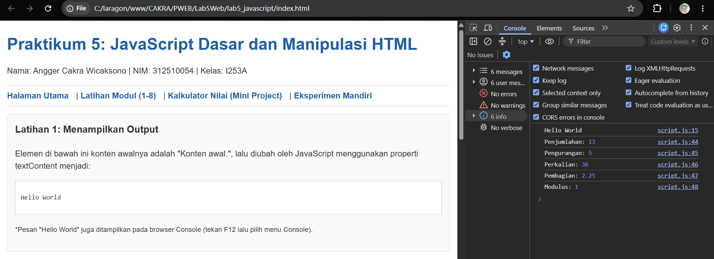
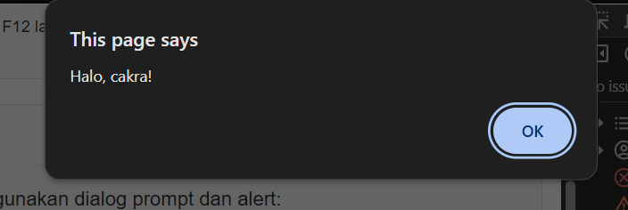
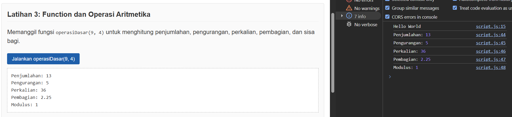
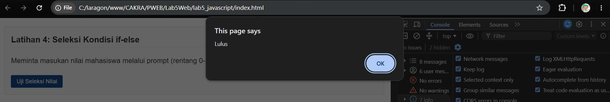
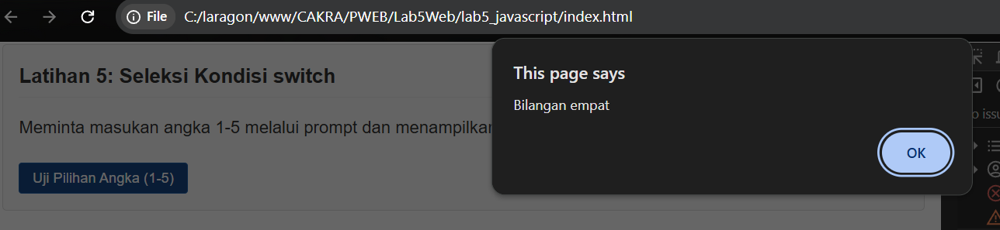
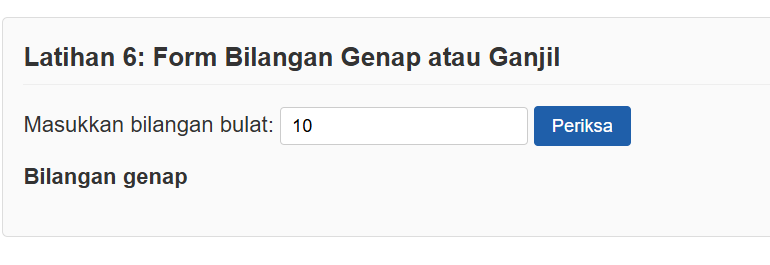
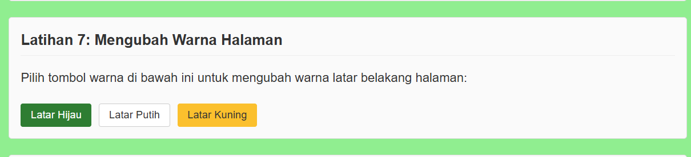
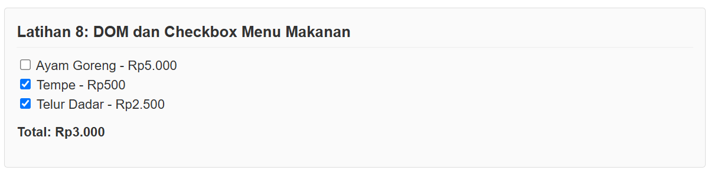
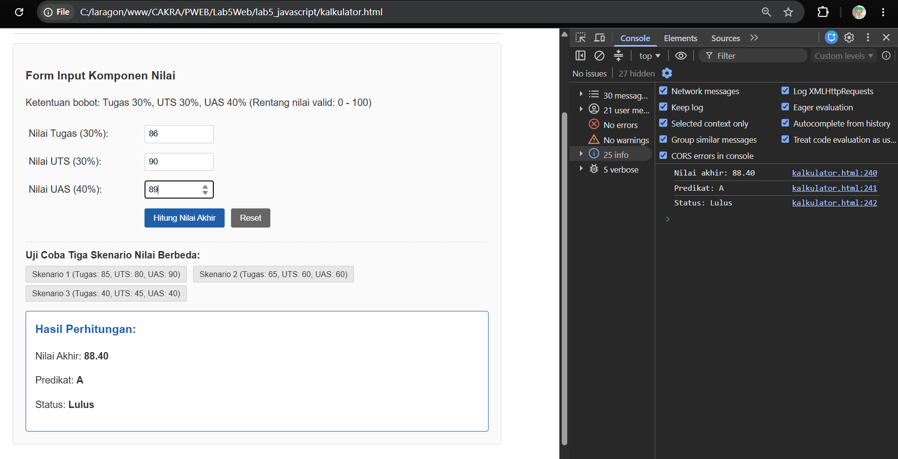
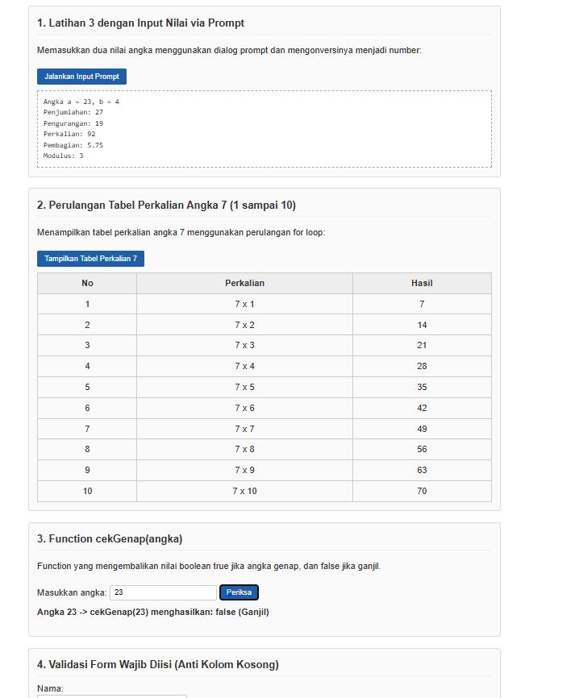

# Praktikum 5: JavaScript Dasar dan Manipulasi HTML

Repository ini dibuat untuk memenuhi tugas **Praktikum 5 - JavaScript Dasar dan Manipulasi HTML** pada mata kuliah Pemrograman Web (Pertemuan 6).

**Identitas Mahasiswa:**
- **Nama:** Angger Cakra Wicaksono
- **NIM:** 312510054
- **Kelas:** I253A
- **Program Studi:** Teknik Informatika
- **Dosen Pengampu:** Agung Nugroho, S.Kom., M.Kom.
- **Kampus:** Universitas Pelita Bangsa

---

## Panduan Screenshot Tugas

Simpan semua file tangkapan layar (screenshot) di dalam folder `screenshots/` dengan format nama angka (`1.png` sampai `10.png`) sesuai tabel berikut:

| No File | Halaman / Dokumen | Yang Harus Di-Screenshot / Ditampilkan |
|---|---|---|
| **`1.png`** | `lab5_javascript/index.html` | **Latihan 1:** Tampilan teks pada halaman yang berubah menjadi "Hello World" menggunakan properti `textContent` dan pesan "Hello World" pada browser Console. |
| **`2.png`** | `lab5_javascript/index.html` | **Latihan 2:** Tampilan dialog masukan `prompt()` saat memasukkan nama, dialog `alert()` sapaan salam, dan teks sambutan pada halaman web. |
| **`3.png`** | `lab5_javascript/index.html` | **Latihan 3:** Tampilan hasil pemanggilan fungsi `operasiDasar(9, 4)` yang mencakup Penjumlahan, Pengurangan, Perkalian, Pembagian, dan Modulus. |
| **`4.png`** | `lab5_javascript/index.html` | **Latihan 4:** Pengujian percabangan `if-else` nilai mahasiswa (rentang 0-100) melalui dialog prompt (contoh nilai 76) yang memunculkan alert "Lulus". |
| **`5.png`** | `lab5_javascript/index.html` | **Latihan 5:** Pengujian percabangan `switch` saat pengguna memasukkan angka 1-5 (contoh angka 2) yang memunculkan alert "Bilangan dua". |
| **`6.png`** | `lab5_javascript/index.html` | **Latihan 6:** Tampilan form pemeriksaan bilangan bulat (contoh memasukkan angka 12) yang menampilkan teks keterangan "Bilangan genap". |
| **`7.png`** | `lab5_javascript/index.html` | **Latihan 7:** Tampilan perubahan warna latar belakang halaman web setelah mengklik tombol pilihan warna (contoh tombol Latar Hijau). |
| **`8.png`** | `lab5_javascript/index.html` | **Latihan 8:** Tampilan form menu makanan berbasis checkbox yang menghitung total harga secara otomatis saat menu dicentang. |
| **`9.png`** | `lab5_javascript/kalkulator.html` | **Mini Project:** Tampilan aplikasi Kalkulator Nilai Mahasiswa (bobot Tugas 30%, UTS 30%, UAS 40%) lengkap dengan hasil nilai akhir, predikat, dan status kelulusan. |
| **`10.png`** | `lab5_javascript/eksperimen.html` | **Eksperimen Mandiri:** Tampilan halaman eksperimen mandiri yang menampilkan tabel perkalian 7 dari loop for, fungsi cekGenap, dan tombol toggle sembunyikan/tampilkan elemen. |

---

## Struktur Folder

```text
Lab5Web/
├── .gitignore
├── README.md
├── index.html
├── screenshots/
│   ├── 1.png
│   ├── 2.png
│   ├── 3.png
│   ├── 4.png
│   ├── 5.png
│   ├── 6.png
│   ├── 7.png
│   ├── 8.png
│   ├── 9.png
│   └── 10.png
└── lab5_javascript/
    ├── index.html
    ├── script.js
    ├── kalkulator.html
    └── eksperimen.html
```

---

## Langkah-langkah Praktikum

### 1. Menampilkan Output (Latihan 1)
Pada latihan pertama, dibuat struktur dasar HTML dan file `script.js`. JavaScript digunakan untuk mengubah isi teks elemen dengan id `pesan` serta mencetak pesan ke browser console:

```javascript
// script.js
document.getElementById("pesan").textContent = "Hello World";
console.log("Hello World");
```

**Hasil Pengujian:**
- Teks pada elemen `<p id="pesan">` yang awalnya berisi "Konten awal." berubah menjadi "Hello World".
- Pada jendela Console browser (Inspect -> Console), pesan "Hello World" berhasil tercetak.

**Screenshot Hasil (Latihan 1):**  


---

### 2. Alert dan Prompt (Latihan 2)
Menggunakan fungsi `prompt()` untuk menerima input dari pengguna dan fungsi `alert()` untuk menampilkan kotak dialog pesan:

```javascript
const namaPengguna = prompt("Masukkan nama Anda:", "");
if (namaPengguna && namaPengguna.trim() !== "") {
    alert("Halo, " + namaPengguna + "!");
    document.getElementById("pesan").textContent = "Selamat datang, " + namaPengguna + ".";
} else {
    alert("Nama belum diisi.");
}
```

**Perilaku Program:**
- Jika nama diisi: muncul alert "Halo, [nama]!" dan teks pada halaman diperbarui.
- Jika input kosong atau hanya spasi: fungsi `trim()` mendeteksi string kosong dan memunculkan alert "Nama belum diisi.".
- Jika tombol Cancel ditekan: prompt menghasilkan nilai `null` sehingga masuk ke blok else "Nama belum diisi.".

**Screenshot Hasil (Latihan 2):**  


---

### 3. Function dan Operasi Aritmetika (Latihan 3)
Membuat function `operasiDasar(a, b)` yang menerima dua parameter bilangan, kemudian menampilkan hasil operasi aritmetika dasar:

```javascript
function operasiDasar(a, b) {
    console.log("Penjumlahan:", a + b);
    console.log("Pengurangan:", a - b);
    console.log("Perkalian:", a * b);
    console.log("Pembagian:", b !== 0 ? a / b : "Tidak dapat dibagi nol");
    console.log("Modulus:", a % b);
}

operasiDasar(9, 4);
```

**Screenshot Hasil (Latihan 3):**  


---

### 4. Seleksi Kondisi if-else (Latihan 4)
Meminta masukan nilai melalui dialog prompt, mengonversi nilai menjadi tipe number, memvalidasi rentang 0-100, lalu mengevaluasi batas kelulusan minimal 60:

```javascript
const inputNilai = prompt("Masukkan nilai (0-100):");
const nilaiMahasiswa = Number(inputNilai);

if (inputNilai === null || inputNilai.trim() === "" ||
    Number.isNaN(nilaiMahasiswa) || nilaiMahasiswa < 0 || nilaiMahasiswa > 100) {
    alert("Input nilai tidak valid.");
} else if (nilaiMahasiswa >= 60) {
    alert("Lulus");
} else {
    alert("Belum lulus");
}
```

**Screenshot Hasil (Latihan 4):**  


---

### 5. Seleksi Kondisi switch (Latihan 5)
Menggunakan struktur `switch-case` untuk menampilkan nama sebutan bilangan dari angka 1 sampai 5:

```javascript
const inputPilihan = prompt("Masukkan angka 1-5:");
switch (inputPilihan) {
    case "1": alert("Bilangan satu"); break;
    case "2": alert("Bilangan dua"); break;
    case "3": alert("Bilangan tiga"); break;
    case "4": alert("Bilangan empat"); break;
    case "5": alert("Bilangan lima"); break;
    default: alert("Pilihan tidak tersedia");
}
```

**Screenshot Hasil (Latihan 5):**  


---

### 6. Form Bilangan Genap atau Ganjil (Latihan 6)
Membuat form input bertipe number pada dokumen HTML. Saat tombol "Periksa" ditekan, fungsi `cekBilangan()` memeriksa apakah angka habis dibagi dua atau tidak:

```html
<label for="bilangan">Masukkan bilangan bulat:</label>
<input type="number" id="bilangan" step="1">
<button type="button" onclick="cekBilangan()">Periksa</button>
<p id="hasilBilangan"></p>
```

```javascript
function cekBilangan() {
    const input = document.getElementById("bilangan").value;
    const angka = Number(input);
    const hasil = document.getElementById("hasilBilangan");

    if (input.trim() === "" || !Number.isInteger(angka)) {
        hasil.textContent = "Masukkan bilangan bulat yang valid.";
    } else if (angka % 2 === 0) {
        hasil.textContent = "Bilangan genap";
    } else {
        hasil.textContent = "Bilangan ganjil";
    }
}
```

**Screenshot Hasil (Latihan 6):**  


---

### 7. Mengubah Warna Halaman (Latihan 7)
Membuat fungsi satu parameter yang dapat mengubah warna latar belakang halaman web secara dinamis:

```javascript
function ubahWarnaLatar(warna) {
    document.body.style.backgroundColor = warna;
}
```

```html
<button type="button" onclick="ubahWarnaLatar('lightgreen')">Latar Hijau</button>
<button type="button" onclick="ubahWarnaLatar('white')">Latar Putih</button>
<button type="button" onclick="ubahWarnaLatar('lightyellow')">Latar Kuning</button>
```

**Screenshot Hasil (Latihan 7):**  


---

### 8. DOM dan Checkbox Menu Makanan (Latihan 8)
Membuat form pemesanan makanan menggunakan checkbox. Total harga akan terhitung secara otomatis setiap kali kotak dicentang atau dilepas:

```html
<h3>Daftar Menu Makanan</h3>
<label><input type="checkbox" class="menu" value="5000"> Ayam Goreng - Rp5.000</label><br>
<label><input type="checkbox" class="menu" value="500"> Tempe - Rp500</label><br>
<label><input type="checkbox" class="menu" value="2500"> Telur Dadar - Rp2.500</label><br>
<p>Total: Rp<span id="total">0</span></p>
```

```javascript
const daftarMenu = document.querySelectorAll(".menu");
daftarMenu.forEach((item) => {
    item.addEventListener("change", hitungTotal);
});

function hitungTotal() {
    let total = 0;
    daftarMenu.forEach((item) => {
        if (item.checked) total += Number(item.value);
    });
    document.getElementById("total").textContent = total.toLocaleString("id-ID");
}
```

**Screenshot Hasil (Latihan 8):**  


---

## Mini Project: Kalkulator Nilai Mahasiswa

Mini project ini mengimplementasikan aplikasi Kalkulator Nilai Mahasiswa yang memisahkan logika perhitungan dari tampilan hasil HTML:

1. **Komponen Bobot Nilai:**
   - Tugas: Bobot 30%
   - UTS: Bobot 30%
   - UAS: Bobot 40%
   - Rumus: `Nilai Akhir = (Tugas * 0.30) + (UTS * 0.30) + (UAS * 0.40)`

2. **Ketentuan Predikat Nilai:**
   - Nilai >= 85: Predikat A (Lulus)
   - Nilai >= 75: Predikat B (Lulus)
   - Nilai >= 60: Predikat C (Lulus)
   - Nilai >= 50: Predikat D (Belum lulus)
   - Nilai < 50: Predikat E (Belum lulus)

3. **Hasil Pengujian Tiga Skenario Nilai Berbeda:**
   - **Skenario 1:** Tugas = 85, UTS = 80, UAS = 90 -> Nilai Akhir = 85.50 | Predikat = A | Status = Lulus
   - **Skenario 2:** Tugas = 65, UTS = 60, UAS = 60 -> Nilai Akhir = 61.50 | Predikat = C | Status = Lulus
   - **Skenario 3:** Tugas = 40, UTS = 45, UAS = 40 -> Nilai Akhir = 41.50 | Predikat = E | Status = Belum lulus

**Screenshot Hasil (Mini Project):**  


---

## Eksperimen Mandiri

Eksperimen mandiri dikerjakan pada file `lab5_javascript/eksperimen.html` sesuai penugasan Bagian G modul:

1. **Latihan 3 dengan Input Prompt:** Memasukkan dua angka melalui dialog prompt secara dinamis dan menampilkannya pada halaman web.
2. **Perulangan Tabel Perkalian Angka 7:** Menampilkan tabel perkalian angka 7 dari 1 sampai 10 menggunakan perulangan for.
3. **Function cekGenap(angka):** Function yang mengembalikan nilai boolean true jika angka genap, dan false jika angka ganjil.
4. **Validasi Form Anti Kolom Kosong:** Memvalidasi kolom nama dan email agar tidak boleh dikirim dalam keadaan kosong atau spasi.
5. **Perluasan Menu Makanan:** Menambahkan dua pilihan menu baru yaitu Nasi Putih (Rp3.000) dan Es Teh Manis (Rp3.000) pada sistem checkbox.
6. **Tombol Toggle Hide dan Show:** Memanipulasi properti `style.display` untuk menyembunyikan dan menampilkan kembali elemen kotak informasi.

**Screenshot Hasil (Eksperimen Mandiri):**  


---

## Pertanyaan dan Tugas

#### 1. Jelaskan perbedaan console.log(), alert(), prompt(), dan textContent / innerHTML!
- **console.log():** Digunakan untuk mencetak pesan atau isi variabel ke konsol browser (DevTools Console). Tujuannya untuk proses pengecekan atau debugging oleh programmer tanpa mengganggu tampilan halaman pengguna.
- **alert():** Menampilkan kotak dialog pesan pop-up yang bersifat modal. Halaman akan berhenti sementara sampai tombol OK diklik.
- **prompt():** Menampilkan kotak dialog pop-up yang meminta input teks dari pengguna. Menghasilkan string jika diisi atau null jika pengguna menekan tombol Cancel.
- **textContent:** Mengatur atau membaca teks murni dari suatu elemen HTML. Karakter khusus akan ditampilkan apa adanya sebagai teks biasa.
- **innerHTML:** Mengatur atau membaca konten di dalam elemen HTML beserta tag-tag HTML-nya, sehingga tag yang dimasukkan akan diterjemahkan oleh browser menjadi elemen HTML.

---

#### 2. Apa perbedaan let dan const? Berikan contoh!
- **let:** Digunakan untuk mendeklarasikan variabel yang nilainya dapat diubah atau diisi ulang di kemudian baris.
- **const:** Digunakan untuk mendeklarasikan variabel konstan yang nilainya tetap dan tidak dapat diisi ulang setelah inisialisasi awal.

Contoh:
```javascript
let nilai = 70;
nilai = 85; // Boleh, nilai variabel dapat berubah

const nama = "Angger";
// nama = "Cakra"; // Error: Assignment to constant variable.
```

---

#### 3. Apa perbedaan operator == dan === ?
- **Operator `==` (Loose Equality):** Membandingkan dua nilai dengan melakukan konversi tipe data otomatis jika tipe datanya berbeda.
- **Operator `===` (Strict Equality):** Membandingkan dua nilai tanpa konversi tipe data. Perbandingan hanya bernilai true jika nilai dan tipe datanya sama persis.

Contoh:
```javascript
console.log(5 == "5");   // true (string "5" dikonversi menjadi number 5)
console.log(5 === "5");  // false (karena tipe data Number berbeda dengan String)
```

---

#### 4. Jelaskan fungsi if-else dan switch. Kapan masing-masing dapat digunakan?
- **if-else:** Digunakan untuk percabangan dengan kondisi logika boolean yang fleksibel. Sangat cocok digunakan untuk menguji kondisi rentang nilai (contoh: `nilai >= 60 && nilai <= 100`) atau kondisi gabungan dengan operator logika (`&&`, `||`).
- **switch:** Digunakan untuk percabangan dengan satu variabel yang dibandingkan terhadap nilai-nilai diskret (pasti). Sangat cocok digunakan jika kita memiliki banyak pilihan nilai pasti, seperti memilih menu nomor 1 sampai 5, kode hari, atau perintah tertentu.

---

#### 5. Apa fungsi parameter dan return dalam function?
- **Parameter:** Variabel penampung yang ditentukan saat membuat fungsi untuk menerima nilai masukan (argumen) dari luar saat fungsi tersebut dipanggil.
- **Return:** Perintah untuk mengembalikan nilai hasil pemrosesan dari dalam fungsi ke pemanggil fungsi tersebut, serta menghentikan eksekusi fungsi.

Contoh:
```javascript
function kali(a, b) { // a dan b adalah parameter
    return a * b;     // return mengembalikan hasil perkalian
}
let hasil = kali(4, 5); // hasil bernilai 20
```

---

#### 6. Bagaimana JavaScript memilih elemen HTML menggunakan document.getElementById()?
Metode `document.getElementById("idElemen")` bekerja dengan cara mencari elemen di dalam dokumen HTML yang memiliki atribut `id` sesuai dengan teks yang dicari. Karena atribut `id` pada HTML harus unik, metode ini langsung mengembalikan satu objek elemen HTML yang bersangkutan agar dapat dimanipulasi isi teks, gaya, maupun atributnya. Jika tidak ditemukan, metode ini akan menghasilkan `null`.

---

#### 7. Buat script untuk memvalidasi form agar nama tidak kosong dan nilai berada pada rentang 0-100!

```html
<form id="formUji" onsubmit="validasi(event)">
    <label for="nama">Nama:</label>
    <input type="text" id="nama"><br><br>

    <label for="nilai">Nilai (0-100):</label>
    <input type="number" id="nilai"><br><br>

    <button type="submit">Kirim</button>
    <p id="pesanValidasi" style="color: red;"></p>
</form>

<script>
function validasi(event) {
    event.preventDefault();

    const nama = document.getElementById("nama").value;
    const inputNilai = document.getElementById("nilai").value;
    const nilai = Number(inputNilai);
    const pesan = document.getElementById("pesanValidasi");

    if (nama.trim() === "") {
        pesan.textContent = "Nama tidak boleh kosong.";
        return;
    }

    if (inputNilai.trim() === "" || isNaN(nilai) || nilai < 0 || nilai > 100) {
        pesan.textContent = "Nilai harus berupa angka di antara 0 sampai 100.";
        return;
    }

    pesan.style.color = "green";
    pesan.textContent = "Data valid! Nama: " + nama + ", Nilai: " + nilai;
}
</script>
```

---

## Checklist Sebelum Dikumpulkan

- [x] Struktur folder `lab5_javascript` dibuat di dalam repositori `Lab5Web`.
- [x] Berkas `index.html` dan `script.js` terhubung dengan benar dan mengimplementasikan Latihan 1 sampai Latihan 8.
- [x] Mini Project Kalkulator Nilai Mahasiswa pada `lab5_javascript/kalkulator.html` memisahkan fungsi perhitungan dan tampilan DOM.
- [x] Tiga skenario nilai pada Mini Project (Nilai Tinggi, Sedang, dan Kurang) telah diuji.
- [x] Berkas `lab5_javascript/eksperimen.html` mengimplementasikan seluruh tugas eksperimen mandiri Bagian G.
- [x] Halaman utama `index.html` berfungsi sebagai portal navigasi.
- [x] Semua screenshot langkah praktikum (`1.png` sampai `10.png`) tersedia di folder `screenshots/`.
- [x] Berkas `README.md` disusun lengkap memuat panduan, langkah kerja, screenshot, dan jawaban pertanyaan modul.
- [x] Berkas `.gitignore` telah ditambahkan.
- [x] Kode dan dokumentasi belum di-push ke remote GitHub untuk keperluan review mandiri.
